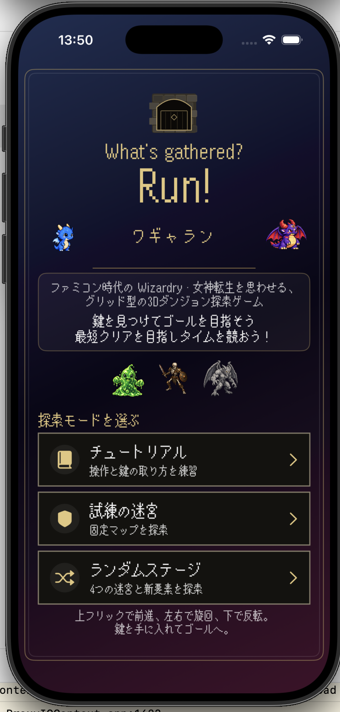

# 日専祭アプリ：マップ探索アプリ

> **チーム：** Aチーム（26CM0101 氏名安住光司、26CM0120 氏名竹岡修一、26CM0130 氏名三浦崇志）
> **AI利用レベル：** 2（生成コード可）
> **最終更新：** 2026-10-09
> 

> 💡 制作の進め方は担任の先生から案内があります。このファイルの項目は、担任の先生の指示で増えることがあります。

---

## 何ができるアプリか（3行）

古典的な3DダンジョンRPG（ウィザードリィ風）の探索を擬似的に体験できます。
画面上のボタンでプレイヤーの方向転換や前進を操作し、前方の壁の有無を確認できます。
画面下部にある2Dミニマップで自分の現在地とゴール（G）までの経路をリアルタイムに確認できます。
ボス戦はしりとりげーむ。

## 画面
 


## 使った文法・技術

ダンジョンゲーム

①SwiftUIの Canvas と switch

使用ファイル：DungeonView.swift

使用部分
```swift
var body: some View {
    Canvas { ctx, size in
        let f = Double(size.width) / 2
        let cx = Double(size.width) / 2
        let cy = Double(size.height) / 2
        // 迷宮の壁や扉などを描画
    }
}
```
使用した文法・技術： SwiftUIの Canvas、switch 文

使用方法： 描画用の座標や画像を使って迷宮を描き、プレイヤーの向きや鍵の取得状態に応じて表示する画像を切り替え。

②深さ優先探索（DFS）と乱数シード

使用ファイル：RandomMazeGenerator.swift

使用部分
```swift
static func generate(seed: UInt64) -> MapData {
    var random = SeededRandomNumberGenerator(seed: seed)

    let start = nodes[
        random.nextInt(upperBound: nodes.count)
    ]

    var visited: Set<GridPos> = [start]
    var stack = [start]
```
使用した文法・技術： 関数、配列、Set、スタック、シード付き乱数

使用方法： 部屋を探索しながら通路をつなぎ、迷宮を自動生成。シード値を利用することで、同じ条件から同じ迷宮を再現できる設計。

しりとりゲーム

①配列処理によるカード候補の抽出

使用ファイル：CPUSelector.swift

使用部分
```swift
let availableCards = cards.filter {
    !$0.isCleared
}

let connectableCandidates =
    availableCards.flatMap { card in
        card.vocabularies.compactMap { vocabulary in
            guard KanaNormalizer.firstCharacter(
                of: vocabulary.word
            ) == currentPrompt else {
                return nil
            }

            return (card: card, vocabulary: vocabulary)
        }
    }
```
使用した文法・技術： filter、flatMap、compactMap、クロージャ

使用方法： 取得済みカードを除外し、残ったカードの読みから、指定された文字で始まる候補だけを抽出する。

②オプショナル型と guard

使用ファイル：CPUSelector.swift

使用部分
```swift
guard !connectableCandidates.isEmpty else {
    return nil
}
```
使用した文法・技術：guard 文、オプショナル型（?）、nil

使用方法：CPUが選べる読みが存在するかを確認する。候補がなければ nil を返し、呼び出し側がCPUの敗北・プレイヤーの勝利処理へ進められるようにする。


## 生成AIの使い方（どの場面で、どう使ったか）

3人が別のAIを使っても齟齬が起きぬよう、
コード開発規約、仕様書、ロードマップの生成


## 展示で工夫した点

（例：文字を大きくして、来場者が操作しやすいようにした。）
